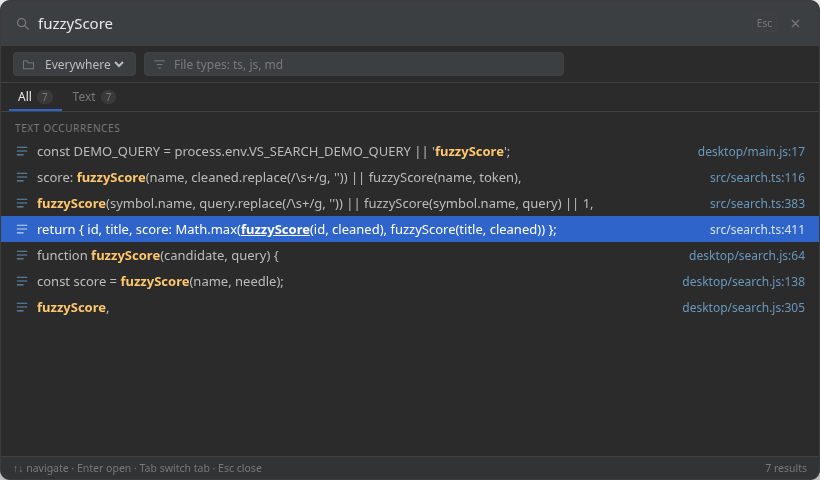

# Scanline

Search files, text, symbols and commands from a single editor tab — with folder-scope and file-type filters. The native engine stays in charge: `findFiles`, workspace symbols, the command registry, and the same `ripgrep` VS Code already uses.


VS Code's built-in search is a sidebar. Scanline gives you the same results in a real half-screen tab beside your editor, with two filters that the built-in UI makes you type by hand: **where** to search and **which file types**.

## Features

- **Half-screen tab, not a sidebar** — opens beside the current editor and stays there while you jump through results
- **Scope filter** — workspace root, any direct sub-folder, or a folder picked with the native directory dialog
- **File-type filter** — `ts, js, md` or `*.py`, applied to both the file list and the text hits
- **Four result groups at once** — `Files` / `Text occurrences` / `Symbols` / `Commands`
- **Never loses your place** — `Enter` opens the hit in the main editor and keeps the search tab open
- **Escape hatch to the native UI** — `Alt+Enter` re-runs the same query, with the same filters, in VS Code's Search Editor
- **Two palettes** — PhpStorm/Darcula, or follow your current VS Code theme

## Usage

- **`Ctrl+Alt+Shift+F`** (`Cmd+Alt+Shift+F` on macOS) — opens the search tab beside the current editor. The icon in the editor title bar does the same thing.
- **Right-click a folder in the Explorer → `Scanline: Search in This Folder`** — opens the tab already scoped to that folder.
- Type — results update live as you type.
- **`Enter`** — opens the selected hit in the main editor. The search tab stays where it is.
- **`Alt+Enter`** — sends the query and filters to the native Search Editor.
- **`Esc`** — closes the tab.

| Key | Action |
| --- | --- |
| `↑` `↓` / `PageUp` `PageDown` | Move through results |
| `Tab` / `Shift+Tab` | Switch between result groups |

## The two filters

1. **Scope** — the folder button next to the input: `Everywhere`, the workspace root, or one of its **direct sub-folders** (for example `scanline/src`). The last entry, `Browse…`, opens the native directory dialog for any folder. Files, text and symbols are all searched inside that path only.
2. **File types** — the `File types` box: `ts, js, md` or `*.py`. Both the file list and the text search are limited to those extensions.

Both filters are carried over to `Alt+Enter`, so the native Search Editor opens with the same `files to include`.

## Commands

| Command ID | What it does |
| --- | --- |
| `scanline.search` | Open the search tab (same as the title-bar icon) |
| `scanline.searchSelection` | Open the search tab with the current selection as the query |
| `scanline.searchInFolder` | Search inside the folder you right-clicked in the Explorer |
| `scanline.searchToSide` | Open the native Search Editor beside the editor |
| `scanline.close` | Close the search tab |

To rebind: `Ctrl+K Ctrl+S` → search for `scanline.search`. Or in `keybindings.json`:

```json
{ "key": "ctrl+shift+alt+f", "command": "scanline.search" }
```

## Settings

| Setting | Default | Description |
| --- | --- | --- |
| `scanline.theme` | `phpstorm` | `phpstorm` = fixed Darcula palette · `vscode` = follow the current theme |
| `scanline.maxResults` | `30` | Maximum results per provider (5–200) |
| `scanline.target` | `searchEditor` | Where `searchToSide` / `Alt+Enter` send the query: `searchEditor` or `sidebarPanel` |
| `scanline.reuseSearchEditor` | `true` | Reuse an existing Search Editor tab instead of opening a new one |
| `scanline.showIncludesExcludes` | `false` | Show the include/exclude inputs in the Search Editor |

## Desktop app (optional)

The same UI as a standalone window in the middle of the screen, above everything:

```bash
cd desktop && npm install && ./run.sh
```



- Bind `desktop/run.sh` to a global shortcut (KDE: System Settings → Shortcuts → Custom → Command)
- Running it again toggles the window closed (single instance)
- Reads the workspace folders from `~/.config/scanline/workspace.json`, which the extension writes on startup
- `Enter` runs `code -g path:line:col` in the existing VS Code window
- Runs with `--ozone-platform=x11`, because Wayland does not let it position its own window

The desktop app is not part of the published extension.

## Requirements

- VS Code **1.90** or newer
- Ripgrep is used when available; without it, text search falls back to scanning the workspace through `workspace.fs`, which is slower

## Development

```bash
npm install
npm run compile        # or: npm run watch
npm run package        # scanline-0.7.1.vsix
code --install-extension scanline-0.7.1.vsix
```

Reload the VS Code window after installing. To debug, open the folder and press `F5`.

## Publishing

Publishing runs in CI through Marketplace Trusted Publishing (OIDC), so no personal access token is stored anywhere:

```bash
npm version patch -m "chore: release %s"
git push --follow-tags
```

The `v*` tag triggers `.github/workflows/publish.yml`, which publishes whatever version is in `package.json`. Make sure the two match — the tag is only the trigger.

To publish from your machine instead, `npx vsce login <publisher-id>` once, then `npm run publish`.

## Project layout

```
media/overlay.html   Shared UI markup (VS Code tab + desktop app)
media/overlay.js     UI logic: typing, tabs, scope, file types, rendering
media/overlay.css    PhpStorm/Darcula styling
src/page.ts          The search tab (webview) and its message protocol
src/search.ts        Providers: files / text (ripgrep) / symbols / commands
src/native.ts        Hands the query to the native Search Editor
src/extension.ts     Commands, the editor/title icon, workspace sync for the desktop app
desktop/             The standalone Electron app
```

## Limitations

- Text search is literal, like PhpStorm's default. Use `Alt+Enter` or `scanline.searchToSide` for regular expressions.
- Without `rg` on the machine, text search is noticeably slower.
- The desktop app has no symbol or command providers.
- Results are capped per provider by `scanline.maxResults`; it is not a paged result list.
