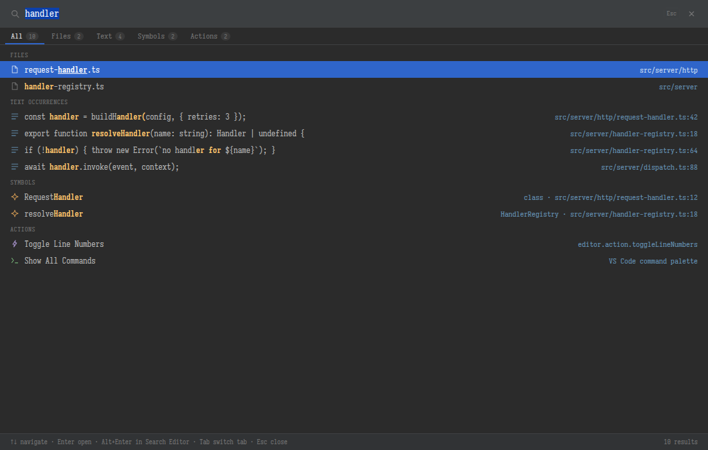

# Search Overlay

سرچ VS Code را به شکل یک باکس شناور وسط صفحه باز می‌کند، با ظاهر PhpStorm/Darcula.
هیچ الگوریتم سرچی از صفر نوشته نشده: فایل‌ها با `workspace.findFiles`، سیمبل‌ها با
`executeWorkspaceSymbolProvider`، دستورها با `commands.getCommands` و متن با همان
موتور `ripgrep` که خود VS Code استفاده می‌کند.

دو حالت نمایش دارد (تنظیم `vsSearch.presentation`):

**`overlay`** (پیش‌فرض) — باکس شناور روی ناحیه ادیتور، مثل PhpStorm:


**`page`** — همان UI ولی تمام‌صفحه داخل یک تب ادیتور معمولی که باز می‌ماند:



## استفاده

`Ctrl+Alt+Shift+F` → باکس باز می‌شود → تایپ کن → `Enter` فایل را روی همان خط باز می‌کند.

| کلید | کار |
| --- | --- |
| `↑` `↓` / `PageUp` `PageDown` | حرکت در نتایج |
| `Enter` | باز کردن نتیجه (فایل/سیمبل → ادیتور روی خط، Action → اجرا) |
| `Alt+Enter` | همان query را در Search Editor نیتیو VS Code باز کن |
| `Tab` / `Shift+Tab` | عوض کردن تب (All / Files / Text / Symbols / Actions) |
| `Esc` | بستن |

## تفاوت `overlay` و `page`

| | `overlay` | `page` |
| --- | --- | --- |
| ظاهر | باکس وسط صفحه + backdrop | تمام ناحیه تب |
| تب ادیتور | موقت؛ با رفتن به تب دیگر خودکار بسته می‌شود | مثل ادیتور عادی باز می‌ماند |
| مناسب برای | باز کردن سریع، مثل Search Everywhere فاب | سرچ طولانی و بالا/پایین رفتن در نتایج |

توجه: ساخت پنلِ کاملاً بدون تب (شناور روی کل پنجره) با API افزونه‌های VS Code ممکن نیست.
در حالت `overlay` یک تب موقت ساخته می‌شود ولی بلافاصله وقتی فوکوس برود حذف می‌شود.

## دستورها

| Command ID | کار |
| --- | --- |
| `vsSearch.search` | با توجه به `vsSearch.ui` و `vsSearch.presentation` |
| `vsSearch.overlay` | همیشه حالت شناور |
| `vsSearch.page` | همیشه حالت تمام‌صفحه |
| `vsSearch.quickPick` | حالت QuickPick نیتیو |
| `vsSearch.searchSelection` | اورلی با متن انتخاب‌شده |
| `vsSearch.searchToSide` | فرستادن query به Search Editor کنار ادیتور |
| `vsSearch.close` | بستن اورلی |
| `vsSearch.clearHistory` | پاک کردن تاریخچه |

عوض کردن کلید: `Ctrl+K Ctrl+S` → `vsSearch.search` → هر ترکیبی که خواستی. یا در `keybindings.json`:

```json
{ "key": "ctrl+shift+alt+f", "command": "vsSearch.search" }
```

## تنظیمات

| Setting | Default | کار |
| --- | --- | --- |
| `vsSearch.ui` | `overlay` | `overlay` = باکس PhpStorm، `quickpick` = QuickPick نیتیو |
| `vsSearch.presentation` | `overlay` | `overlay` = شناور، `page` = تب تمام‌صفحه |
| `vsSearch.theme` | `phpstorm` | `phpstorm` = پالت Darcula، `vscode` = رنگ‌های تم فعلی VS Code |
| `vsSearch.maxResults` | `30` | سقف نتیجه برای هر منبع |
| `vsSearch.target` | `searchEditor` | مقصد `searchToSide` / `Alt+Enter` (`searchEditor` یا `sidebarPanel`) |
| `vsSearch.reuseSearchEditor` | `true` | استفاده مجدد از تب Search Editor |
| `vsSearch.showIncludesExcludes` | `false` | نمایش فیلد include/exclude در Search Editor |
| `vsSearch.title` | `Search Everywhere` | تیتر حالت QuickPick |
| `vsSearch.historyLimit` | `25` | تعداد queryهای اخیر در حالت QuickPick |

## نصب و بیلد

```bash
npm install
npm run compile
npm run package                       # vs-search-overlay-0.3.0.vsix
code --install-extension vs-search-overlay-0.3.0.vsix
```

بعد از نصب پنجره VS Code را reload کن. برای دیباگ: پوشه را باز کن و `F5` بزن.

## ساختار

```
src/extension.ts   ثبت commandها و انتخاب UI
src/overlay.ts     WebviewPanel + پروتکل پیام با UI (دو حالت overlay/page)
src/search.ts      providers: files / text (ripgrep) / symbols / commands
src/native.ts      فرستادن query به Search Editor نیتیو
src/quickpick.ts   حالت QuickPick
media/             HTML/CSS/JS داخل webview
```

## محدودیت‌ها

- Webview در VS Code نمی‌تواند روی کل پنجره (سایدبار + پنل) شناور شود؛ حالت `overlay` روی
  ناحیه ادیتور رندر می‌شود و تبش موقتی است.
- اگر `rg` روی سیستم نباشد، جست‌وجوی متن به اسکن فایل‌ها با API خود VS Code سقوط می‌کند (کندتر).
- جست‌وجوی متن literal است (مثل حالت پیش‌فرض PhpStorm). برای regex از `Alt+Enter` و Search Editor استفاده کن.
